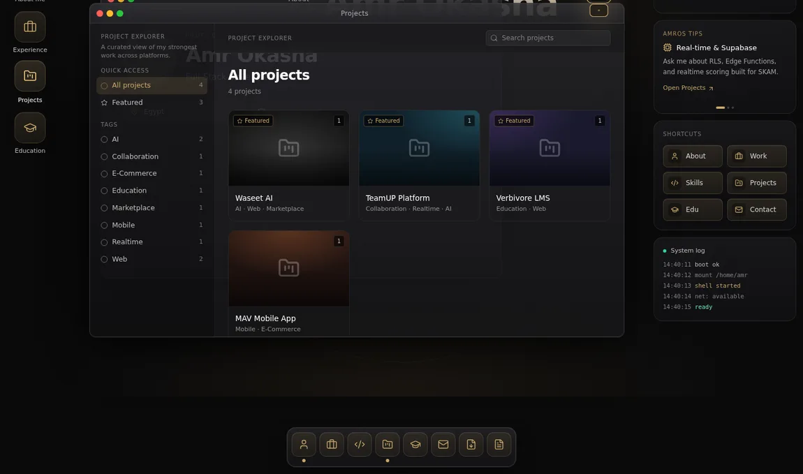

# AmrOS Portfolio

An interactive desktop-style portfolio for Amr Okasha. Visitors can open, move, and switch between windows to explore projects, skills, experience, and contact information. Smaller screens use a dedicated mobile layout.

[Open the live portfolio](https://portfolio-six-beta-fsv8cxz8pj.vercel.app/)



*The preview shows the actual interface with local sample records.*

## How it works

| Layer | Implementation |
| --- | --- |
| Interface | React, TypeScript, Tailwind CSS, and Framer Motion |
| Desktop shell | Window state, stacking, and minimize/restore in `src/os/` |
| Public content | Supabase-backed profile, projects, skills, experience, education, and links |
| Content management | Supabase Auth and a built-in admin screen at `/#/admin` |

## Run locally

Use Node.js 22.12+ and npm.

```bash
npm ci
```

Create `.env.local` in the repository root.

```dotenv
VITE_SUPABASE_URL=https://your-project.supabase.co
VITE_SUPABASE_ANON_KEY=your-public-anon-or-publishable-key
```

Use a development Supabase project with the portfolio tables listed in [the generated types](src/lib/database.types.ts), read policies for public content, and sample records. Admin editing also needs an authorized account, write policies, and Storage configuration for uploads. The repository includes client types rather than a database bootstrap, so installing dependencies does not provision these resources. Browser environment variables must contain client-safe values.

```bash
npm run dev
npm run build
npm run lint
```

Public UI components are in [`src/components/`](src/components/), Supabase queries in [`src/lib/services.ts`](src/lib/services.ts), and content editors in [`src/admin/`](src/admin/).
